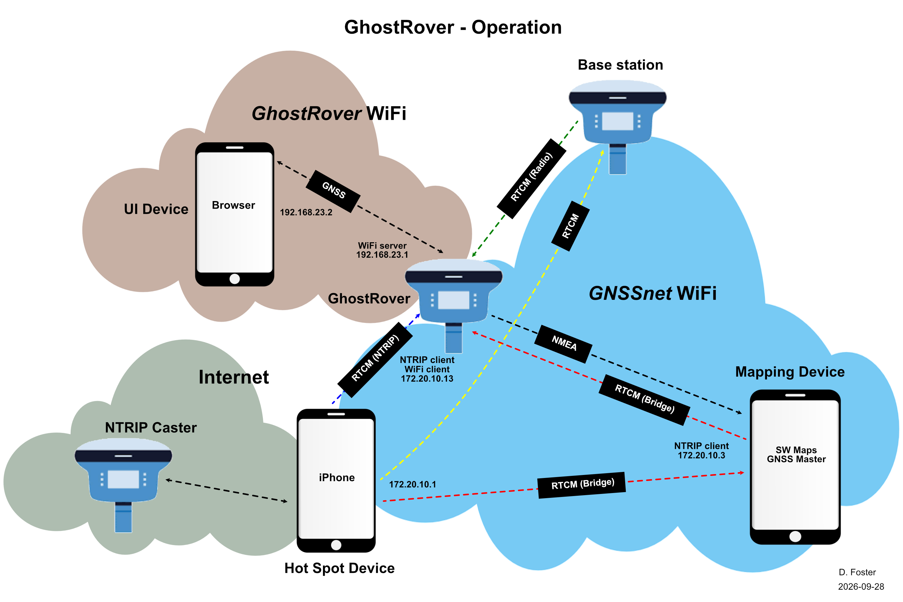
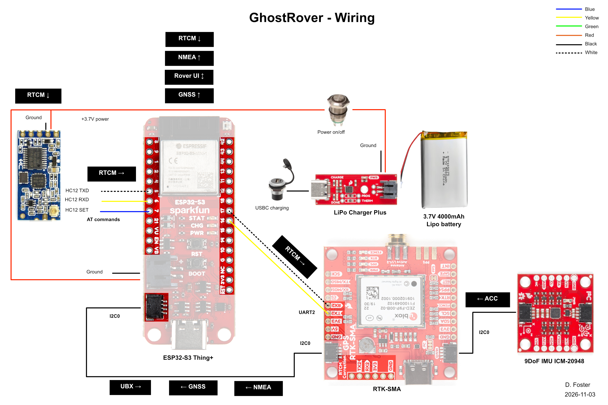
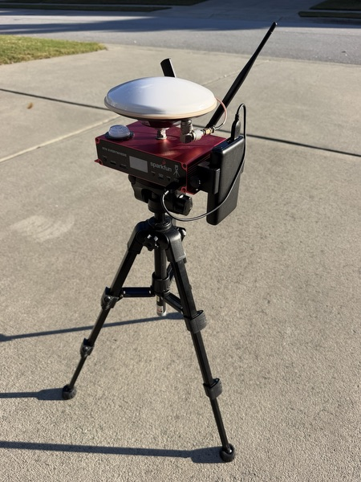
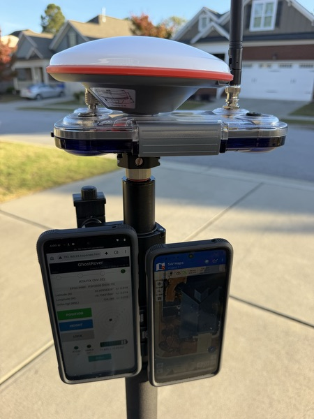
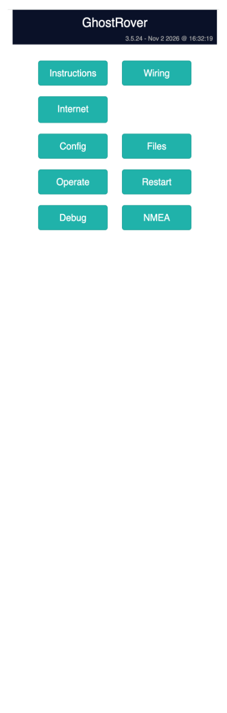
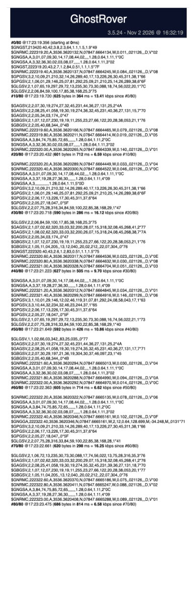

# GhostRover&trade; - V 3.5
Last update: 2026-11-08 (V 3.5.24)

## Table of Contents
[GitHub repository](#github-repository) 
[Description](#description) 
[User interface](#user-interface) 
[GNSS coordinate locking](#gnss-coordinate-locking) 
[Bubble level](#bubble-level) 
[Hardware](#hardware) 
[Photos & evolution](#photos--evolution) 
[Software](#software) 
[UI snapshots](#ui-snapshots) 
[References](#references) 
[Caveats](#caveats) 
[Thoughts](#thoughts) 
[To Do](#to-do) 
[Bug fixes](#bug-fixes) 
[License](#license) 
[About me](#about-me) 

## GitHub repository
[&uarr;](#table-of-contents) 

* https://github.com/doug-foster/DougFoster_Ghost_Rover

## Description
[&uarr;](#table-of-contents) 

GhostRover is an "invisible" GNSS rover.

Invisible?

Let's say you want to record a survey point by using a geo-located photo. The object's GNSS position and height can be recorded by first locating the object with GhostRover, then locking its coordinates using the UI. The rover can then be moved out of the picture.

The result is an uncluttered photo of the object with its exact position and height recorded in the photo meta data. This is ideal for locating and photographing visual objects such as cemetery headstones, benchmarks, artifacts, etc.

GhostRover is a GNSS rover. It can receive input RTCM corrections from:
1. An external NTRIP client over TCP/IP via an internet hot spot
2. An internal NTRIP client over TCP/IP via an internet hot spot
3. A base station over point-to-point radio.

GhostRover outputs NMEA sentences over TCP/IP to a TCP client (GNSS Master) running on the Mapping device. The NMEA sentences are then forwarded internally to the Mapping software (SW Maps). Survey points and photos are recorded using SW Maps.

## User interface
[&uarr;](#table-of-contents) 

GhostRover is managed & operated via a set of web pages running in a Chrome browser on the UI device (refer to [UI snapshots](#ui-snapshots)).

Clicking the common header on any page will return you to the main menu.

There are ten unique pages, but these are the primary three: 

<a href="#menu-snap">Menu</a> - The main (home) page with several buttons:
* Instructions - Brief summary of how to operate GhostRover.
* Wiring - The wiring diagram (same as in the Hardware section below).
* Internet - Connect/disconnect the secondary WiFi interface to an internet hot spot.
* NTRIP - Connect/disconnect GhostRover to an NTRIP caster on the Internet.
* Config - Update all configuration options for GhostRover.
* Files - View/download/upload (drag & drop) all UI files (log.txt contains boot/debug messages for each restart).
* Operate - The main GNSS operation page. 
* Restart - Reboot GhostRover.
* Debug - Turn on/off all debug options. Messages are recorded to log.txt on the micro SD card.
* NMEA - Realtime display of NMEA sentences generated by the GNSS receiver.

<a href="#config-snap">Config</a> - Used to manage GhostRover's configuration. Options stored as NVS (Non Volatile Storage) preferences:
* Units - Meters or standard (not US Survey) feet.
* RTCM source - Off, Bridge (external NTRIP client), NTRIP (internal NTRIP client), or Radio (base station).
* GNSS lock interval - The # of seconds to average GNSS position/height readings before fixing for this survey point.
* Calibrate IMU - The X & Y offsets (degrees) to account for IMU not being mounted perfectly level in the enclosure.
* Instrument height - GhostRover height (APC offset, antenna, quick release, etc) + selectable holding options & preset lengths (or an optional custom length) = total instrument height (always in mm).
* Generate PVT - Selectable options for GNSS measurement and navigation rates.
* WiFi (STA mode) - SSID & password for the secondary WiFi interface.
* Attributes for up to (3) NTRIP casters - ID, name, URL, mount point, port, version (1/2), user, password, CRS (Coordinate Reference System used for RTCM data), flag to send $GGA NMEA sentence to caster.
* Checkbox - Display WebSocket messages on Chrome Inspect's JS console.

<a href="#operate-snap">Operate</a> - Used to operate GhostRover. The following is displayed:
* GNSS fix type (None, Single, RTK-Float, RTK-Fix)
* Coordinates @ 1mm precision:
    * EPSG:9707 (EPSG:4326 + EPSG:5773) Note: changes to specific RTCM CRS if being received.
        * Latitude (8 decimal degrees)
        * Longitude (8 decimal degrees)
        * Horizontal accuracy
        * Vertical accuracy
    * EPSG:5773 (EGM96 Geoid, H = h - N)
        * Height (Ortho (MSL) - H*)
        * Height (Ellipsoid (HAE) - h)
        * Geoid Separation - N*
    * EPSG:4978 (ECEF)
        * X
        * Y
        * Z
    * EPSG:32617 / 32618 (UTM 17N / 18N)
        * Grid Zone
        * Easting (X)
        * Northing (Y)
* Three operational buttons:
    * Height - The current GNSS height (ellipsoidal and geoid separation) - can be locked/unlocked.
    * Position - The current GNSS 2D position can be locked/unlocked.
    * Lock - Both current height & position can be locked/unlocked.
* RTCM in, NMEA out LED indicators
* Battery (charge amount & discharge rate)
* Bubble level - Displays the degrees of offset adjusted tilt (-5 to +5) from plumb as "bubble level."
* Status - Button reveals hidden table of all GhostRover status data being received in real time:
    * Config preferences, uptime, WebSocket message stats, RTCM message stats, NMEA message stats, WiFi (primary & secondary) stats.

## GNSS coordinate locking
[&uarr;](#table-of-contents)

When a button is pressed (e.g. lock mode), a blinking lock icon is displayed on the button. The blinking lock icon remains for a length of time (set by a configuration preference) while the received coordinates are averaged. Once averaged, the respective coordinates are frozen and all NMEA messages sent from GhostRover to the mapping software will contain those frozen coordinates (with a new, correctly calculated sentence checksum). During this time GhostRover can be physically moved, but the "spoofed" coordinates used by the mapping software remain frozen. Once the survey point has been recorded and geo-located photos taken, the button can be pressed again to unlock and instantly return to normal operation.

The lock averaging process takes place on GhostRover's MCU (not in the UI's JavaScript). It's rather complex and uses a combination of MAD (Median Absolute Deviation) and Welford's online algorithm for running mean/variance. There is a circular buffer for the samples, from which MAD throws out the outliers. The Welford algorithm folds in all non-outliers and accumulates a running mean. I'll try to write up a better explanation summary later, but for now review the code. It's complex, but it's also more accurate than just a standard summation/average of the readings during the lock period. 

## Bubble level
[&uarr;](#table-of-contents)

The operate page contains a bubble level which is driven by the accelerometer on the 9DoF IMU breakout board. Rather than calculate tilt offset adjusted position, GhostRover relies on the operator to hold the pole steady and plumb. The bubble level has (5) radial concentric circles spaced at 1 degree intervals. The operator is given realtime visual feedback by the position of the "bubble" within the concentric circles. The SingularXYZ survey pole also has a traditional bubble level (albeit small and hard to read). The bubble level UI component is immediately to the right of the three lock buttons, making it quite easy to maintain the pole within 1-2 degrees of plumb while locking/averaging the position & height values. This is a low cost (< $20) IMU and not an expensive, super precise IMU like might be used in more expensive GNSS rovers. However, the ICM-20948 seems accurate to about 1 degree with maybe 0.5 degree drift when stationary, so IMO it's a reasonably cost effective choice. Just about any 3DOF accelerometer board should work though (you'll have to account for a difference between IMU libraries).

## Hardware
[&uarr;](#table-of-contents)

### Rover

* MCU board
    * SparkFun Thing Plus ESP32-S3 - https://www.sparkfun.com/sparkfun-thing-plus-esp32-s3.html
* GNSS board
    * SparkFun GPS-RTK-SMA Breakout - https://www.sparkfun.com/sparkfun-gps-rtk-sma-breakout-zed-f9p-qwiic.html
    * ZED-F9P (Qwiic) - I2C address 0x42
* IMU board
    * SparkFun 9DoF IMU Breakout ICM-20948 (Qwiic) - https://www.sparkfun.com/sparkfun-9dof-imu-breakout-icm-20948-qwiic.html
* GNSS antenna
    * SparkFun GNSS Surveying Antenna - https://www.sparkfun.com/gnss-multi-band-l1-l2-l5-surveying-antenna-tnc-spk6618h.html
    * Multi-Band L1/L2/L5
    * TNC-F connector
        * Adapter (TNC-M to SMA-M) - https://www.amazon.com/dp/B0BGPJP3J3
        * Adapter (SMA-M to SMA-F) - https://www.amazon.com/dp/B00VHAZ0KW
        * Cable (SMA-F bulkhead to SMA-M, 6" RG316) - https://www.amazon.com/dp/B081BHHPHQ
    * Mounting thread adapter - https://www.sparkfun.com/antenna-thread-adapter-1-4in-to-5-8in.html
* Radio (point-to-point)
    * HiLetgo HC-12 433MHz SI4438 - https://www.amazon.com/dp/B01MYTE1XR
    * 433.4-473.0 MHz, 100mW
    * U.FL connector
    * Antenna
        * Bingfu Wireless Microphone Receiver Antenna - https://www.amazon.com/dp/B07R4PGZK3
        * UHF 400-960 MHz
        * BNC-M connector
        * Cable (BNC-F bulkhead to U.FL, 8" RG178) - https://www.amazon.com/dp/B098HX6NFH
* UI device
    * StraightTalk Motorola G 5G, 64GB - https://www.walmart.com/ip/ST-MOTOROLA-XT2513V-CDMA-LTE-GRAY-HANDSET-64GB-WALMART-POSA/14552506783
* Mapping device
    * StraightTalk Motorola G 5G, 64GB - https://www.walmart.com/ip/ST-MOTOROLA-XT2513V-CDMA-LTE-GRAY-HANDSET-64GB-WALMART-POSA/14552506783
 * Misc.
    * Micro SD card - https://www.amazon.com/dp/B0BDYVC5TD
        * SanDisk 128GB ImageMate microSDXC UHS-1 - Up to 140MB/s.
    * I2C Qwiic cable kit - https://www.amazon.com/dp/B08HQ1VSVL
    * Push button switch (12mm latching) - https://www.amazon.com/dp/B0BXPFW69R
    * SparkFun LiPo Charger Plus - https://www.sparkfun.com/sparkfun-lipo-charger-plus.html
    * 3.7V Lipo battery (4000mAh) - https://www.amazon.com/dp/B0CNLNY597
    * Battery pack (+5V 2.4A max, 8000 mAh) - https://www.walmart.com/ip/onn-8000mAh-Portable-Battery-Power-Bank-with-USB-A-to-C-Charging-Cable-LED-Indicator-Black/5266111773
    * Enclosure - 7.9” x 4.89” x 1.02”
        * Outdoor Products Large SmartPhone Watertight Phone Case - https://www.dickssportinggoods.com/p/outdoor-products-smartphone-watertight-phone-case-17oprulrgsmrtphnbpas/17oprulrgsmrtphnbpas
    * FALCAM F38 Quick Release - https://www.amazon.com/dp/B0CPPHWW9D
    * Other - 22 & 26 ga wire, heat shrink tubing

### Base station
* Base
    * SparkFun RTK EVK - https://www.sparkfun.com/sparkfun-rtk-evk.html
* GNSS antenna
    * Same components as Rover.
* RTCM relay MCU board
    * SparkFun Thing Plus ESP32-S3 - https://www.sparkfun.com/sparkfun-thing-plus-esp32-s3.html
* Radio (point-to-point)
    * Same components as Rover.
* Misc.
    * Battery pack - Same component as Rover.
    * Battery/smartphone holder - Same component as Rover.
    * LED (5mm) - https://www.amazon.com/dp/B0739RYXVC
    * LED cover (5mm LED bulb socket) - https://www.amazon.com/dp/B07CQ6TH14
    * PCB screw terminal block connector (female) - https://www.amazon.com/dp/B0BPHLZ8XN
        * 3.5mm/ 0.14 in. pitch 10 pin pluggable
    * Other - 1/4-20 thread rod & nuts, 22 & 26 ga wire, heat shrink tubing, 1.25" round bubble level

### Mounting

* Rover (hold by pole)
    * FALCAM F38 Quick Release - https://www.amazon.com/dp/B0CPPHWW9D
    * Aluminum SingularXYZ GPS pole (5.91ft/1.8m telescoping) - https://www.amazon.com/dp/B0F9FLFXLV
    * 5/8-11 F to 1/4-20 M adapter (stainless steel, .375"/9.53mm high) - https://www.amazon.com/dp/B0DYHTQWZW
    * Magnetic phone/tripod mount (qty 3) - https://www.amazon.com/dp/B0D21RP69C
    * Off-Road LED Light Mounting Bracket (qty 4) - https://www.amazon.com/dp/B0C893CB7C
    * Battery/smartphone holder - https://www.amazon.com/dp/B07S8TTH34
    * Other - 1/4-20 bolt, washers, nuts, USB-A power cable
* Rover (hold by hand)
    * FALCAM F38 Quick Release - https://www.amazon.com/dp/B0CPPHWW9D
    * Pistol grip handle - https://www.amazon.com/dp/B01FUEXLGU
    * Mini tripod legs - https://www.amazon.com/dp/B07GST1C2Z
* Base
    * Mini tripod - https://www.amazon.com/dp/B0CQ6WTRW6
    * Laser pointer - https://www.petsmart.com/cat/toys/interactive-and-electronic/whisker-city-thrills-and-chills-laser-cat-toy-84577.html

## Photos & evolution
[&uarr;](#table-of-contents)

### Temporary base - all versions
The base really hasn't changed since the first rover version. The GNSS receiver is a SparkFun RTK EVK with a GNSS multi-band L1/L2/L5 surveying antenna mounted on top. I added an 8000 mAh battery pack which powers the EVK for around 6-8 hours. Inside I mounted an ESP32-S3 (overkill) and an HC-12 radio. The rover has a corresponding HC-12 radio. If the user chooses base mode on the EVK, RTCM correction data will be transmitted point-to-point over the radios to the rover.

The tripod is a low cost, mini camera tripod with a cat toy laser pointer (seriously, but it works well) mounted inside the center column of the tripod. The base tripod is positioned over a known reference point using the laser pointer. The EVK runs SparkFun's "RTK Everywhere" firmware (https://docs.sparkfun.com/SparkFun_RTK_Everywhere_Firmware/introduction/).
<table>
    <tr>
        <td>Base</td>
        <td>Base - laser alignment</td>
    </tr>
    <tr>
        <td></td>
        <td></td>
    </tr>
</table>
<table>
    <tr>
        <td>Base - back</td>
        <td>Base - relay and radio inside</td>
    </tr>
    <tr>
        <td></td>
        <td></td>
    </tr>
</table>

### Rover - Version 0
Version 0 of the rover was not a GNSS receiver, it was a very simple rig designed to test the range of the HC-12 radios. I tested them in our neighborhood (many houses & trees for interference) and in a heavily wooded area. They worked well for my intended usage - and they're cheap! LoRa radios would have _way_ better range, but again for my use case (mapping historical sites & cemeteries) the HC-12 radios will cover the distance needed. Based on good test results, I moved ahead to create version 1 of the rover.
<table>
    <tr>
        <td>V0 Rover HC-12 radio test</td>
        <td>V0 Rover HC-12 range test</td>
    </tr>
    <tr>
        <td></td>
        <td></td>
    </tr>
</table>

### Rover - Version 1
My original intent was for the rover to be hand held. Another laser pointer (err ... cat toy) was externally attached to the rover's hand grip. At this time there was no NMEA output, and the only RTCM input was from the base over the HC-12 radios. Inside the rover was just the GNSS board (SparkFun GPS-RTK-SMA Breakout) and an MCU (I believe I was using an ESP32-C6 Thing Plus at that time.) There were indicator LEDs on the front of the enclosure as well as SparkFun's Qwiic OLED (1.3in., 128x64) display. At that point I just wanted to get some positions out of the GNSS board and onto the display. The enclosure was small but everything was crammed tight. Too tight. It all fit, but not really. I kept breaking soldered wire connections and the only way to get into the case was to remove (4) screws and split it open. While the OLED display was fun and kinda cool, I had 2-3 of them go bad. Also and more importantly, the display was barely visible when you were out in the daytime sun. Version 1 was a nice learning experience, but it was time to rethink the design. Also I needed to integrate it with SW Maps, which I hadn't done yet.
<table>
    <tr>
        <td>V1 Rover and base</td>
        <td>V1 Rover inside</td>
    </tr>
    <tr>
        <td></td>
        <td></td>
    </tr>
</table>

### Rover - Version 2
Version 2 was a major rethink. I still used physical LEDs (flashing lights are fun) and the same OLED display module. But this time I switched to a larger, clam shell styled case (from Pelican). That gave me much more room. I also added Bluetooth for NMEA out to SW Maps. I started with SW Maps on my iPhone, but quickly found out that the Android version was better supported with more features. Based on that, I decided to get a (low cost) Android Samsung tablet. Inside the house it displayed SW Maps quite nicely. Outside in the sun, it wasn't bright enough. In bright daylight the screen was barely visible. I started to realize how I've always taken the display quality of my iPhone for granted. I added the first version of the locking algorithm for position/height coordinates. At that time I used a physical latching button to lock and unlock. GhostRover was born. I also decided to move the Bluetooth processing off the ESP32 (which was now an ESP32-S3) and onto a dedicated ESP32 (a Seeed Studio XIAO ESP32S3). The two MCUs were connected over a secondary I2C bus. I also moved the battery pack to inside the case (in Version 1 it was mounted on the hand grip along with the laser pointer), but eventually changed from a battery pack to a LiPo battery and a "SparkFun LiPo Charger Plus" for recharging. The complexity had jumped significantly, but it was starting to shape up as a nice little physical package. However, after field testing I discovered several things: 1) the tablet had to go, 2) the OLED display had to go, 3) locking had to be improved, 4) the unit would never "lock in" to RTK-Fix and stay there - it jumped around from 3D to Float to Fix back to 3D ... it was exasperating. 
<table>
    <tr>
        <td>V2 Rover and base</td>
        <td>V2 Rover inside</td>
    </tr>
    <tr>
        <td></td>
        <td></td>
    </tr>
</table>

### Rover - Version 3
Version 2 did have some big improvements, but it was unreliable and just not field friendly. So, I redesigned again. For simplicity I switched out the Seeed XIAO ESP32S3 for another Sparkfun ESP32-S3 Thing Plus. I still thought I wanted to keep Bluetooth off the main MCU (IMO the library is a pig), so I kept the secondary MCU. I also got tired of broken wires so I decided to solder pins on to the MCUs and use connectors. I removed the OLED display and went with a web based display for control. I found I could buy a locked StraightTalk Motorola phone at Walmart for $30 and only use it over WiFi, never activating the carrier service. And it was quite visible in daylight! For $60 I bought two - one to replace the OLED display and physical LEDs and buttons, and the second for SW Maps. Awesome. To this day it's the configuration I use. It did mean though that I had to build a web server on the ESP32 and implement WebSockets over TCP/IP/WiFi for communication from the web UI on the phone to the ESP32. That took a while. In fact, quite a while. Since I'd shifted quite a bit of functionality from physical to virtual, and had a flat LiPo battery, I could go with a smaller case. I still used a Pelican clam shell style case, but everything fit much nicer. Somewhere between Version 3.0 and 3.5.24 I made what I hope are the final changes. Those are described under Version 3.5.
<table>
    <tr>
        <td>V3 Rover and phone display</td>
        <td>V3 Rover inside</td>
    </tr>
    <tr>
        <td></td>
        <td></td>
    </tr>
</table>

### Rover - Version 3.5
Versions 3.1-3.5 all had incremental changes. I've lost track, but in general here's what I did. I needed a way to hold the two Motorola phones (one for GhostRover controller and the other for SW Maps), plus also something to hold my iPhone/Verizon hot spot. I found an affordable, collapsible survey pole on Amazon. With some clamps and magnetic holders (they're really strong), everything fits nicely on the pole. I even added a clamp for an external battery pack if I wanted to recharge the LiPO, but  that will not be normally used. The LiPO should give me plenty of time on a single charge. Since I went with a pole mount, I decided to ditch the laser pointer. It works well when locating the base station, but not so well with the rover now mounted on a pole. That freed up room. I also decided to change from sending NMEA over Bluetooth to sending it to SW Maps over TCP/IP/WiFi. That meant I could remove the second ESP32-S3 dedicated to running Bluetooth and run the NMEA/TCP process on the main MCU. It was a piece of cake. I run GNSS Master as a second app on the SW Maps phone, and it receives the NMEA stream over TCP/IP/WiFi and passes it to SW Maps. Works like a charm and while it is a second setup step, it's super simple and seems to be (so far) very reliable. I also built options into GhostRover to receive RTCM streams from an NTRIP server (besides the base station) using the NTRIP client running either directly on GhostRover or running on the phone under SW Maps. Both seem quite reliable. With more room in the enclosure now that the laser pointer and second MCU were gone, I decided to add an IMU. I wanted to keep it simple, so instead of calculating tilt compensation into the positions, I just use the accelerometer in the IMU for a bubble level. See the photos below. Works awesome, replaces a physical bubble level on the survey pole, and is very intuitive to use. Even with the new IMU board, I had excess room in the Pelican enclosure, so I found a thin/flat/cheaper waterproof enclosure meant for cell phones. It is still a clam shell design so I can easily open the unit if I need to connect a USB cable from my computer directly to the MCU or GNSS board. The new enclosure meant I could clean up the wiring again, so by this version I've got the wiring down to a reliable minimum. I use a camera quick connector on the bottom of the case to hold it on the pole; that works quite nicely. I can even remove the rover from the pole and use it as a handheld device if I have a survey partner holding/running the phone displays. The software got LOTS of revisions and cleanup, and enhancements (like the status display on the operate page as well as the multiple CRS conversions which can be displayed/hidden).

<table>
    <tr>
        <td>V3.5 Rover on survey pole</td>
        <td>V3.5 Rover</td>
    </tr>
    <tr>
        <td></td>
        <td></td>
    </tr>
</table>
<table>
    <tr>
        <td>V3.5 Rover front</td>
        <td>V3.5 Rover inside</td>
    </tr>
    <tr>
        <td></td>
        <td></td>
    </tr>
</table>
<table>
    <tr>
        <td>V3.5 Rover quick release</td>
        <td>V3.5 Rover case charge and radio</td>
    </tr>
    <tr>
        <td></td>
        <td></td>
    </tr>
</table>
<table>
    <tr>
        <td>V3.5 Rover case power and antenna</td>
        <td>V3.5 Rover spare battery & hot spot</td>
    </tr>
    <tr>
        <td></td>
        <td></td>
    </tr>
</table>
<table>
    <tr>
        <td>V3.5 Rover phone displays</td>
        <td>V3.5 Rover control</td>
    </tr>
    <tr>
        <td></td>
        <td></td>
    </tr>
</table>
<table>
    <tr>
        <td>V3.5 Rover GNSS Master</td>
        <td>V3.5 Rover SW Maps</td>
    </tr>
    <tr>
        <td></td>
        <td></td>
    </tr>
</table>

## Software
[&uarr;](#table-of-contents) 

### DougFoster_Ghost_Rover.ino
The code (C, HTML, CSS, & JS) has _lots_ of comments.
* Docs: Comments - Points to this README.md file.
* Docs: Code organization - Lists the 10 primary sections in the code:
    *  Docs
    *  Include libraries
    *  Global vars
    *  General functions
    *  Setup functions
    *  FreeRTOS functions
    *  Library event handlers
    *  Loop functions
    *  Setup
    *  Loop
* Docs: Code operation - A nice summary of what's in the code and what it does, grouped into these sections:
    * Boot
    * Run setup()
    * FreeRTOS functions
    * Library event handlers
    * Run loop()
* Docs: Board LED status - What LEDs light up and what they signify.
* Docs: Instrument height calculations - How the instrument heights were calculated.

After the Docs sections, the code follows the described order listed in Code organization. Each section (e.g. Include libraries) has a doc-block and descriptions.
* To understand how the code works, review the "Setup" and "Loop" sections first.
* Next review the "FreeRTOS functions" and "Library event handlers." In a way these are much like the "Loop" functions (continuously looping), but run independently of the main Arduino "Loop."
* Then review the remaining sections and understand where/when they are called by "Setup", "Loop", "FreeRTOS functions", & "Library event handlers."
* Lastly, review the UI HTML, CSS, and JS files.

Pay special attention to the doc-block and comments preceding processMessagesIn(). This is where most of the action happens. Operational data formatted as JSON KV pairs is exchanged between GhostRover and the UI device over WebSockets. Many of the data elements use an integer number as a proxy for the var name. This was done to keep packet sizes minimal during frequent data exchanges between GhostRover and the UI. The JSON key index is listed in the comments as well as the general protocol exchange for each UI page.

Debug can be initiated from either a serial USB command line prompt or the "Debug" UI page. Both act the same. Messages are displayed on the serial USB line if one is connected, as well as recorded to the UI file "log.txt" created at each boot and saved on the micro SD card. Debug can be toggled on and off.

A nice trick is to use a VSC Live Server extension and run GhostRover's web UI on the dev machine (the one you're using VSC on) instead of running it on the actual UI device. Browse to 127.0.0.1:5500/ui instead of 192.168.23.1 and you can try out code, debug JS with Chrome Inspect, and make changes on the fly. The only thing you can't do is upload a file from your dev machine to GhostRover's SD card (think about it). You have to be connected to GhostRover's web server (192.168.23.1) to do that. You can also view the same UI page at the same time on different devices, say one on your dev machine and one on the actual UI device. This can really help with debugging. Remember though, once you have the final code, you need to save it to GhostRover's micro SD card using the drag & drop feature on the "Files" UI page.

If you make changes to the code, be careful of how functions running independently (loop, FreeRTOS, & library) can affect one another. Using flags can help minimize unplanned function-to-function interactions.

### UI device
* Android OS
* Chrome web browser
* HTML, CSS, JS files in "ui" sub-directory

### Mapping device
* Android OS
* GNSS Master - https://www.gnssmaster.com
    * Uses TCP/IP (not BLE) to receive NMEA from Rover. Forwards to SW Maps mapping software.
    * Optional NTRIP client
* SW Maps - https://aviyaantech.com/swmaps/
    * Receives NMEA from Rover via "GNSS Master"

### IDE
* Visual Studio Code (VSC) - https://code.visualstudio.com
* Arduino Maker Workshop VSC extension - https://marketplace.visualstudio.com/items?itemName=TheLastOutpostWorkshop.arduino-maker-workshop
    * Version 1.1.11 (10/2/2026, 6:29:17 AM)
    * Runs packaged Arduino CLI version 1.2.0
* Other VSC extensions - Better Comments, Bookmarks, C/C++, C/C++ DevTools, C/C++ Extension Pack, C/C++ Themes, Code Runner, Dash, Diff folders, Git Graph, GitHub Theme, GitLens, Live Server, open in browser, Peacock. 

### Platform
* Arduino Release v3.3.11 based on ESP-IDF v5.5.5 - https://github.com/espressif/arduino-esp32/releases#release-3.3.11

### FQBN
* "SparkFun ESP32-S3 Thing Plus" - ~/Library/Arduino15/packages/esp32/hardware/esp32/3.3.11/boards.txt

## UI snapshots
[&uarr;](#table-of-contents)

<table>
    <tr>
        <td id="operate-snap">Operate page - normal (<a href="#user-interface">&uarr;UI)</a></td>
        <td>Operate page - conversions display (Click coordinates area to toggle.)</td>
    </tr>
    <tr>
        <td></td>
        <td></td>
    </tr>
</table>
<table>
    <tr>
        <td>Operate page - status display (Click "Status" button to toggle.)</td>
    </tr>
    <tr>
        <td></td>
    </tr>
</table>
<table>
    <tr>
        <td id="config-snap">Config page - top (<a href="#user-interface">&uarr;UI)</a> (Can save 3 NTRIP server configs.)</td>
        <td>Config page - bottom</td>
    </tr>
    <tr>
        <td></td>
        <td></td>
    </tr>
</table>
<table>
    <tr>
        <td id="files-snap">Files page - top  (<a href="#user-interface">&uarr;UI)</a> (Drag/drop to upload.)</td>
        <td>Files page - bottom</td>
    </tr>
    <tr>
        <td></td>
        <td></td>
    </tr>
</table>
<table>
    <tr>
        <td id="menu-snap">Menu page (<a href="#user-interface">&uarr;UI)</a></td>
        <td id="debug-snap">Debug page - top (<a href="#user-interface">&uarr;UI)</a> (Mirrors CLI debug.)</td>
    </tr>
    <tr>
        <td></td>
        <td></td>
    </tr>
</table>
<table>
    <tr>
        <td id="nmea-snap">NMEA page (<a href="#user-interface">&uarr;UI)</a></td>
    </tr>
    <tr>
        <td></td>
    </tr>
</table>

## References
[&uarr;](#table-of-contents) 

* EVK - https://docs.sparkfun.com/SparkFun_RTK_EVK/introduction/
* HC-12 - https://www.elecrow.com/download/HC-12.pdf
* PyGPSClient - https://github.com/semuconsulting/PyGPSClient
* RTK - https://learn.sparkfun.com/tutorials/what-is-gps-rtk/all
* NMEA Reference - https://cdn.sparkfun.com/assets/a/3/2/f/a/NMEA_Reference_Manual-Rev2.1-Dec07.pdf
* NMEA Analyser - https://swairlearn.bluecover.pt/nmea_analyser
* SparkFun - https://learn.sparkfun.com/tutorials/tags/gnss
* Pin config - https://roboticsbackend.com/arduino-uno-pins-a-complete-practical-guide/
* NVS preferences - https://docs.espressif.com/projects/arduino-esp32/en/latest/tutorials/preferences.html

## Caveats
[&uarr;](#table-of-contents) 

* None known.

## Thoughts
[&uarr;](#table-of-contents) 

#### 2026-10-06 - Post project
* BLE vs TCP - I changed from BLE to TCP/IP for NMEA relay since the BleSerial library is a space pig (see GNSS Master). I don't understand why a block data protocol like Bluetooth is considered de facto when TCP streams are designed for guaranteed and ordered streaming data.
* What didn't work: Displays. - This is the third major instantiation of GhostRover. The first two versions used a SparkFun 1.3in., 128x64 OLED display (https://www.sparkfun.com/sparkfun-qwiic-oled-1-3in-128x64.html) instead of the web based UI. In direct sunlight, it was impossible to read. And the amount of data you could present was limited. And the characters were tiny. And I had several of them just mysteriously die. It didn't work. I also tried a Samsung Android tablet, but it was barely visible in direct sunlight and cumbersome. So I finally figured out I could buy two cheap, locked Android phones at Walmart and just never use the cell service. They seem to have pretty good visibility in direct sunlight. Plus good battery life. Plus a nice amount of display real estate. So I can get lots of stuff on the UI device, and run the mapping software on the other phone.
* What didn't work: Hand held operation. - Originally I built GhostRover as a handheld unit. I also included a laser pointer and provided a button on the UI. The idea was I could eliminate a survey pole by just holding the unit over my target (like a cemetery headstone), center it using the laser, and then go into lock & record mode. Well, that also went by the wayside. The laser too was hampered by bright sunlight, and while I played with changes that made it incrementally brighter, ultimately it wasn't bright enough. Add in the fact that operation now required 3 additional devices (UI device, Mapping device, and internet hot spot device) - and it got to be a bit ungainly. In fact, with the "UFO" antenna, the clear oblong case, and a device (UI & mapping) mounted on each side of the case, it looked like a mini Starship Enterprise! Hah. So I ditched the idea of a handheld only device and went with a survey pole. This lets me attach the rover to the top of the pole, but still quickly remove it via the FALCAM F38 quick release if/when I need to. And all 3 of the devices (plus an optional mount for a 5V battery pack) attach to the pole but are also quickly removable. It's a bit bigger now, but I think the change is going to be worth it.
* What worked but was a PITA: BLE. - Originally I used BLE to send NMEA from GhostRover to SW Maps. The BLE library sucked so much memory that I was afraid I wouldn't have enough left for my application. The SparkFun guys manage it with one MCU, but I decided I'd use two: one for the main GhostRover functions, and the second for just BLE. Get NMEA in from the GNSS module over I2C1, and send out over I2C2 to the dedicated ESP32-S3 for BLE. That worked, but added more wires and also more complexity. I'm not an ESP32 memory management guru like they are, so I stepped back and thought about it. And I found the GNSS Master Android app which supported TCP/IP. I was already running TCP on GhostRover for the web interface, so it was super simple to spin it up for NMEA. Works like a dream. So ultimately I was able to get down to just one ESP32-S3 (my favorite) and eliminate I2C2 as well as some cables. So far, so good. GNSS Master also has a built in NTRIP client - so I adapted GhostRover to use either it (external) or an NTRIP client running directly on the MCU (internal). Both seem to work well. We'll see which one I end up using the most.
* What kinda worked: SW Maps on iPhone. - It seems obvious that the devs for SW Maps prefer Android OS as opposed to iOS. While it works on IOS, I don't think it gets the TLC that the Android version does. So I decided to keep it simple, Android for the UI & Mapping devices, and my iPhone for the internet hot spot.
* What worked surprisingly well: HC-12 point-to-point radios. - It's not like using a set of 1 watt LoRa radios (which I might switch to later on), but it was cheap and they worked great. When I began building version 1 of GhostRover, I did a distance test of the radios. I was really surprised. For my application, if I set up a temporary base in a cemetery, chances are good I'll usually be within sight of the base. I even did a field test in the forest where we're doing our historical preservation project, and was amazed at how far I got before they dropped off. So for the cost ($10 for a pair), they're perfect. Besides, I may find I use direct NTRIP connections from either PointPerfect's Flex service or NC CORS (maybe) more often. I'll decide after I start putting it to work in the field.
* Idea: Add an IMU for heading and tilt corrections. - I'm going to see if I can get by with the ICM-20948 ($20) rather than the IM19 ($200).
    * 2026-11-03: As of version 3.5.24 I have the ICM-20948 (now discontinued ... sigh) in and working. I didn't end up using the gyro, and I decided to not use the magnetometer (originally intended for heading). Since I knew the IMU was low cost, I decided to take a simple approach (hah) and just use it to plumb the survey pole when locking position and height readings. In the end, it works well. The "bubble level" UI component on the operate page is quite effective and easy to use. And it's probably as accurate as a physical bubble level, but IMO much easier to read & use since it's right next to the lock buttons. I like it. It averages out the readings and with some other tricks the bubble appears to move smoothly - like a bubble!

* Idea: 3D print a case. - I started with this case (https://www.sparkfun.com/hand-held-enclosure-abs-plastic.html) for GhostRover version 1. That was when I was using the OLED display. It was small - that's the good and the bad. Not much room for wires. As a result, I was constantly breaking wires/solder joints when I had to get into it. And intermittent loose connections ... it just didn't work. Then I switched to the Pelican Micro Case 1040. That's worked fairly well as I prototyped. Everything fits with room to spare, including the internal LiPo battery. And I can see the board LEDs through the clear case. And when I need to connect a serial USB to the ESP32-S3, I can pop the case open easily. When I'm done, snap the lid and it's waterproof (kinda). That all said, it's not very stylish - and 3D printing is pretty cool. I think I can come up with a better design. For now, the Pelican works, but I think I can do better - especially now that the laser and second ESP32-S3 have been eliminated.

* I found a thin iPhone style case at Dick's Sporting Goods for $15 and switched to it from the Pelican (see the photos). I like it; I might not hassle with 3D printing a case. Or I might. Time will tell.

#### 2026-11-03 - Claude as a coding partner

* As I got to the end of the version 3.5 work (installing the IMU), I decided to try using Claude AI as a coding partner. At first I let Claude suggest snippets of code which I reviewed, tweaked, then added. I'd say 95% of the code in 3.5.24 is mine. However, as I kept using Claude I was absolutely blown away at its (his?) ability to debug the code and find incredibly obscure yet fatal errors. Increasingly I began to trust his (ok - I'll use his for now) judgement. Eventually I used his suggestions as-is, especially when it came to the GNSS locking algorithms and the averaging algorithms. I'm not a pro Arduino coder, in fact this was my first major Arduino project (3.5.24 represents the 4th generation of GhostRover). Claude was an incredible help for deciphering library calls and especially when I got into using mutexes and isolating thread-buffer overwrites. After wrapping up the IMU add, I asked Claude to review the whole project (C, html, CSS, & JS files) and to make some cleanup suggestions. He generated a list of about 20 which I pared down to 15 or so. Some were substantial improvements, some were nit-picking tweaks. I did feel they all were good, but as we progressed through the list, I'd let Claude describe why the cleanup was necessary, generate a git patch, apply the patch & test, then commit the changes and sync the new version from my local copy of the repository up to GitHub. I did feel I had to push back sometimes, he got a bit presumptive. But push back on a few suggestions and he started to fall back in line as a coding partner - not a team lead. Once while debugging why the IMU kept locking up, he really got into the weeds. Deeper than I thought made sense; but I let him go - just to see where we'd end up. Eventually, I made some physical cabling changes and (funny) the problem disappeared. I backed out his 6 or so diagnostic patches, and told him. He was like "Oh, ok. Physical problem. Moving on now ..." Argh. So lesson learned, give him some rope, but hold back implicit trust and judgement. At least for now. But like other devs I've followed, we all tend to come to the same conclusion (as of late 2026).

#### 2026-11-03 - Claude's review
* Claude's review: Finally, I did ask Claude to review version 3.5.24 and make some "high level" suggestions for what might be a cleaner architecture. You have to realize, I've gone from novice Arduino guy to understanding FreeRTOS (somewhat) and making a pretty big piece of code work. Along the way, the code has evolved. Like any dev would say, it's never done and can always be redone better the next time. Live and learn. For now, I'm going to settle with the current structure, but here was what Claude suggested might be a set of next steps.

    #### Claude's comments

    "... I’ll ground this in the actual code rather than from memory of our patch work. First: the project notes, the repo layout, and the shape of the sketch and the UI. ... I have the stated requirements from the README. Now I’ll measure the sketch’s actual structure: section sizes, the biggest functions, global-state counts, and how the browser protocol is dispatched. ... The big decisions were right, and I don’t see a case for a rewrite. The weaknesses are about structure: where things live and how many places one change touches. They are cheap to describe and mostly not worth retrofitting into a working 3.5.24.

    ##### What I’d keep

    * The browser as the display: The UI runs on a cheap phone, and its files live on the SD card. It’s plain HTML and JS with no framework, and your README explains why the OLED, tablet and BLE two-board versions lost. Heavy math (UTM and ECEF) stays in the browser, in operate.js.
    * Lock averaging and NMEA rewriting on the MCU: The mapping app has to see frozen coordinates whether or not the UI phone is connected.
    * A dedicated RTCM task on core 0 and a queue for incoming WebSocket messages: Both fixed real crashes, and both are the right pattern.
    * One flat sketch with a fixed section order. That is idiomatic Arduino and easy to navigate.

    ##### What I’d do differently

    * Separate “GNSS engine” from “UI data”. I confirmed this in the code: taskBuildOperData calls buildOperData(), which calls roverGNSS.getPVT(). That call pumps the receiver data and fires processNMEA, which forwards NMEA over TCP and applies the lock substitution. So your product’s primary output is driven by a task named for building browser data.

    * The lock averaging sits in buildOperData() after an early return unless the browser is on the “operate” page. As far as I can tell, averaging would pause if the phone leaves that page or its screen locks mid-average. NMEA output would continue, because getPVT() runs before the check. I haven’t tested that. It’s worth checking in the field. A cleaner shape is one GNSS task that owns the receiver, NMEA out and lock state, and publishes a snapshot. The UI task would only read that snapshot.

    * Table-driven preferences. Take prfLckAvgInt as the example. It appears in about 13 places in the sketch and about 15 lines across three UI files, and the sketch has about 20 preferences and 44 numeric JSON keys. A table of {NVS name, JSON key, type, pointer, default, min, max} would turn “add a preference” into one line. It would also remove a class of drift we hit in this review: stale char[6] comments, and clamp rules that differed between PREF_READ and setPrefsValid().

    * A command table instead of a 600-line processMessagesIn(). Use an array of {key, handler} with one small function per command, about 21 of them. This is the biggest debugging aid, because most of the action happens in that one function.

    * Readable JSON keys. Numeric keys like "52" save little. By the buffer sizes in the code, the periodic message is about 1 KB at 5 Hz, which is a few KB/s over local WiFi. Names like lckAvg would be far easier to debug. I haven’t measured the packets, so treat that as an estimate.

    * Split the sketch into tabs. Put prefs, GNSS/NMEA/lock, NTRIP/RTCM, web, and IMU in separate files in the same folder. Arduino concatenates them into one build, so it changes no behavior. It mainly gives you smaller diffs and easier navigation. Verify the build order once.

    * On the UI side, global.js (about 1,070 lines) mixes WebSocket plumbing with message handling for several pages, and one handler runs roughly 500 lines. Moving page-specific handling into each page’s JS would make it more modular.

    * Smaller items: the “every N ms” tasks group unrelated duties by period instead of by purpose, and the many shared globals and flags across seven tasks are what caused the outputBuffer race. A simple ownership rule would help: each subsystem writes its own state, and others read published snapshots.

    ##### What I would NOT do differently

    * No classes, no event bus, no RTOS frameworks, no rewrite. Your plain C style fits this project.

## To do
[&uarr;](#table-of-contents)

* GhostRover is an evolving project. As of 2026-11-08, it's ready for testing, verification, and use in the field.
* <s>Add SparkFun 9DoF IMU Breakout ICM-20948 (Qwiic) - https://www.sparkfun.com/sparkfun-9dof-imu-breakout-icm-20948-qwiic.html</s>

## Bug fixes
[&uarr;](#table-of-contents)

If you would like to fork your own version of GhostRover, run with it! This project is intended only for my personal use, but shared publicly in the spirit of Open Source software. Hopefully it can provide you with inspiration for your own variation. As such, bug fixes and feature additions are welcomed but not encouraged. 

## License
[&uarr;](#table-of-contents)

This program is free software: you can redistribute it and/or modify it under the terms of the GNU General Public License as published by the Free Software Foundation, either version 3 of the License, or (at your option) any later version.

This program is distributed in the hope that it will be useful, but WITHOUT ANY WARRANTY; without even the implied warranty of MERCHANTABILITY or FITNESS FOR A PARTICULAR PURPOSE. See the GNU General Public License for more details.

A copy of the GNU General Public License is [included](LICENSE.txt) in this repository. Please also refer to https://www.gnu.org/licenses/.

## About me
[&uarr;](#table-of-contents)

You can learn more about me at https://dougfoster.me.